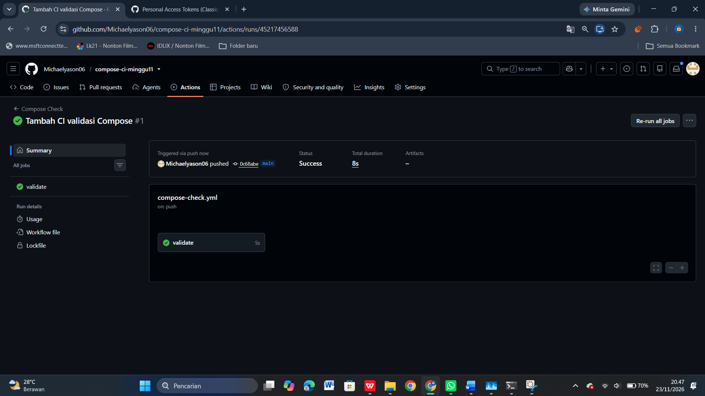
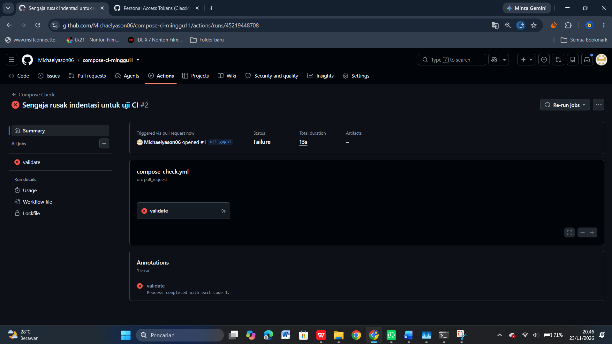
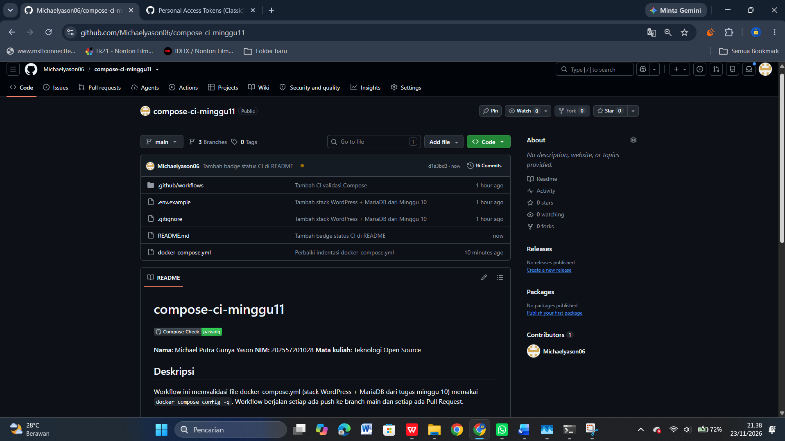

# compose-ci-minggu11

 
**Nama:** Michael Putra Gunya Yason
**NIM:** 202557201028
**Mata kuliah:** Teknologi Open Source (TOS)
 
## Deskripsi
Workflow ini memvalidasi file docker-compose.yml (stack WordPress +
MariaDB dari tugas minggu 10) memakai `docker compose config -q`.
Workflow berjalan setiap ada push ke branch main dan setiap ada
Pull Request.
 
## Isi repositori
- .github/workflows/compose-check.yml : workflow CI
- docker-compose.yml : stack WordPress + MariaDB (tugas minggu 10)
- .env.example : contoh variabel lingkungan tanpa rahasia asli
- .gitignore : mengabaikan .env
 
## Cara kerja workflow
Workflow dipicu oleh push ke main dan oleh pull_request. Ada satu job
bernama validate yang berjalan di ubuntu-latest dengan tiga step:
checkout kode, menyalin .env.example menjadi .env, lalu menjalankan
docker compose config -q untuk memeriksa file Compose. Jika file
rusak, step terakhir gagal dan check berwarna merah.
 
## Bukti
1. Run hijau di tab Actions

2. Pull Request dengan check gagal (merah)

3. Badge status di README

 
Tautan Pull Request (sudah hijau dan di-merge): https://github.com/Michaelyason06/compose-ci-minggu11/actions/runs/45228180897
  
## Refleksi singkat
Dari tugas ini saya jadi paham bahwa CI bukan sekadar tambahan, tetapi penjaga yang memeriksa pekerjaan kita setiap kali ada perubahan. Kesalahan kecil seperti satu spasi yang salah di file Compose bisa langsung ketahuan di GitHub, tanpa harus menunggu ada yang menjalankan stack-nya. Untuk tugas atau proyek berikutnya, saya ingin membiasakan memasang CI sejak awal, terutama kalau dikerjakan bersama teman, supaya perubahan dari siapa pun diperiksa dengan cara yang sama.
